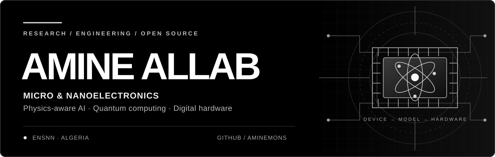

<!--
  AMINE ALLAB · GitHub profile README
  Monochrome edition · assets/hero.svg and assets/footer.svg are required.
-->

  

   

  
  
  
  

   
  Fourth-year engineering student in Micro &amp; Nanoelectronics · École Nationale Supérieure de Nanosciences et Nanotechnologies (ENSNN), Algeria

---

### `01 / ABOUT`

I work at the intersection of **semiconductor physics, machine learning, quantum computing, and digital hardware**. I'm interested in what happens when an algorithm has to respect the system that will actually execute it — noise, device variability, circuit topology, latency, and energy.

My background combines engineering studies in **micro/nanoelectronics** with hands-on software development and research-oriented computational projects. I use software to explore physical systems, build experimental pipelines, and connect promising models to hardware constraints.

> **Current direction:** Physics-guided machine learning for nanoelectronic devices, hardware-aware quantum algorithms, and efficient AI acceleration.

### `02 / SELECTED RESEARCH & ENGINEERING`

**[01 — FinFET RTN Transformer](https://github.com/aminemons/FinFET_RTN_Transformer)**  
*Semiconductor device physics · Deep learning · Signal processing*  
Exploring a physics-informed, dual-head Transformer to recover noisy random telegraph signals and estimate carrier-trap capture/emission time constants in nanoscale transistors.

**[02 — AS-QCNN-PUF-Auth](https://github.com/aminemons/AS-QCNN-PUF-Auth)**  
*Quantum machine learning · Nanoelectronic security · FPGA pipeline*  
A hybrid quantum-classical learning pipeline for physically unclonable function (PUF) response modeling, with exported quantum gate matrices designed for a fixed-point FPGA implementation handoff.

**[03 — Hardware-Aware VQC](https://github.com/aminemons/Hardware-Aware-VQC-Pro)**  
*Variational quantum circuits · NISQ hardware · Quantum transpilation*  
Experiments with data re-uploading, hardware-efficient ansätze, qubit connectivity constraints, and circuit transpilation to evaluate practical classifier designs.

**[04 — Hybrid Quantum/Classical Arabic OCR](https://github.com/aminemons/Quantum-Vision-Transformer-Arabic-OCR)**  
*Computer vision · Hybrid quantum models · Experimental benchmarking*  
A comparative research pipeline testing classical image-recognition models against hybrid quantum-classical architectures, with attention to model size, noisy inputs, and limited training data.

---

### `03 / RESEARCH EXPERIENCE`

**Centre de Développement des Technologies Avancées (CDTA) · 2026**  
**AI-based optimization of microheaters for gas sensors**  
Worked on modeling, simulation, and machine-learning-based optimization of microheater designs to reduce power consumption while preserving thermal performance.

**Research interests**  
Semiconductor reliability and device modeling · Gas and photonic sensing · Quantum machine learning · Hardware/software co-design · FPGA acceleration

---

### `04 / TECHNICAL TOOLKIT`

**Electronics & hardware**  

**AI, numerical computing & quantum**  

**Software, systems & deployment**  

---

### `05 / ALSO BUILDING`

Beyond scientific computing, I build production-oriented web applications and tools. My software background includes **TypeScript, React/Next.js, Python, and backend systems** — skills I use to bring research workflows from simulation to usable tools.

- **[Worldwide Microelectronics Opportunity Atlas](https://github.com/aminemons/stagesmicroelectronics-scholarships-professors-contacts)** — A searchable directory of research placements, laboratories, academic contacts, scholarships, and competitions; records are clearly differentiated by verification status.
- **[Portfolio](https://allabamine.dev/)** — Selected software projects, experiments, and work.

---

### `06 / COLLABORATION`

I am interested in collaborating on **nanoelectronic device modeling, physics-informed ML, quantum algorithms, FPGA design, and sensing systems**. Especially interested in projects that connect a physical problem, a reproducible computational method, and a realistic hardware implementation path.

**Contact:** [a.allab@nsnn.edu.dz](mailto:a.allab@nsnn.edu.dz) · [LinkedIn](https://www.linkedin.com/in/amine-allab-3b84ab2b3/) · [Portfolio](https://allabamine.dev/)

 

  

